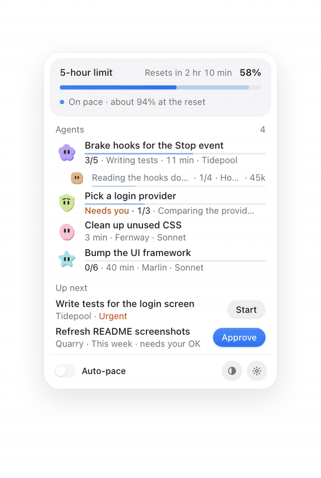
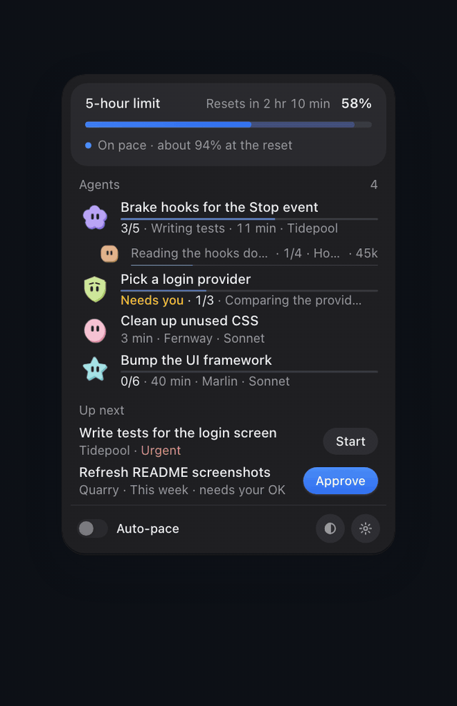

# Kadans

A speedometer for your Claude Code usage limits, in the macOS menu bar. (*Kadans* is Turkish for cadence: the steady
rhythm a cyclist keeps.)

<p align="center">
  
  &nbsp;
  
  <br>
  <sub><a href="docs/images/kadans-demo.mp4">Watch the demo as a video (23 s)</a></sub>
</p>

Kadans shows how fast you use your Claude limit, where you will land at the reset, and what each agent is doing. Slow,
pause, compact, replace or stop an agent with one click. It runs on your Mac and is free and open source (MIT).

## Install

```sh
npx kadans@latest setup
```

- It shows what it will change in your Claude Code settings and asks before it writes anything (a backup comes first).
- It builds the menu bar app on your Mac and opens it.
- Run the same command again to update.

**Requirements:** macOS 13 or newer, Node.js 22 or newer, and Claude Code on a Pro or Max plan (Claude Code only shares
usage data on those plans). The menu bar app needs Apple's Command Line Tools; if they are missing, setup tells you how to
add them, and the hooks and `npx kadans status` work in the meantime.

In this file, `kadans` means `npx kadans`.

<details>
<summary>What setup changes in Claude Code</summary>

Setup writes to your Claude Code `settings.json` (`~/.claude/settings.json`, or the folder in `CLAUDE_CONFIG_DIR`) only
after you answer yes. Before writing, it copies the file to `settings.json.kadans-backup-<time>`. Entries from other tools
are left alone.

| Where | What it does |
|---|---|
| Status line | Records usage samples and prints a one-line gauge. Your old command is saved and restored on uninstall. |
| `Stop` hook | Throttle: can hand one approved task to a session when part of your limit would go unused. Off unless you opt in. |
| `PreToolUse` on `Agent` and `Workflow` | Brake: holds new sub-agents and workflows while the brake is on. |
| `PreToolUse` and `PostToolUse` on every tool | Pace: waits before a tool call if you slowed that session, halts it if you paused it. Auto-pace adds a short note when usage runs hot. |
| `SessionStart`, `PreToolUse` on `Read`, `PostToolUse` on `Bash`, `Read`, `Grep` | Lean mode: a short token-saving brief at session start, a note when an agent re-reads an unchanged file, a note after very large output. Notes only, never blocks. |
| Session events and `Notification` | A small event log, so the agent list knows what runs and what needs you. |

Every hook fails open: if Kadans errors, Claude Code carries on as if it were not there.

If you already had a status line script, set `"chain"` in `~/.kadans/config.json` to its path. Kadans runs it with the same
input, so tools that rely on it keep working. The preview tells you when your status line differs from the chained path.

</details>

<details>
<summary>From source</summary>

```sh
git clone https://github.com/egemenmermer/kadans.git && cd kadans && node bin/kadans.mjs setup
```

From a checkout, `node bin/kadans.mjs <command>` works like `kadans <command>`. `scripts/build-app.sh` builds and signs the
app on its own (`--no-install` builds without copying it to `~/Applications`). Nothing starts at login. Because you built
it yourself, macOS normally opens it without a warning. If it does warn, right-click the app, choose Open, then confirm.

</details>

## What you get

- **Speedometer.** Your 5-hour window, and the 7-day window if your plan has one, with your pace and where you will land
  at the reset. An old reading dims and says how old it is. The menu bar face shows your tightest limit.
- **Brake and throttle.** If your pace would use up a window early, Kadans holds *new* sub-agents and workflows and tells
  Claude why. Running work keeps going. The throttle (off by default) can start a task you approved when quota would go
  unused. Auto-pace, a switch in the panel, asks hot sessions to read less and slows them if the brake holds 10 minutes.
- **Agents list.** Every Claude Code session and sub-agent with its state (working, needs you, slowed, idle), progress,
  context size and sub-agent spend. Drag rows into your own order and double-click a title to rename it; smart titles
  name the other chats from what they are about now. Slow, pause, compact, replace or stop one with a click; close idle
  chats one by one or all at once. Every action that ends something asks first.
- **Lean mode.** On by default: short notes that save tokens, such as when an agent re-reads a file that did not change.
  `kadans config set lean false` turns it off.
- **Codex limits.** If you also use the Codex CLI, its limits show next to Claude's, read-only.
- **Other computers.** If you use Orca, agents on your other machines (Windows too) appear under their own heading.
  On the other computer run `npx kadans connect`, then paste the code it shows in Settings › Computers › Add.
- **Phone control.** The same panel on your phone, over your Wi-Fi or Tailscale.

## Phone

1. On the Mac: Settings › Phone › On.
2. Scan the QR code with your phone's camera, on the same Wi-Fi or over Tailscale.
3. In Safari: Share › Add to Home Screen, then open Kadans from there.

A pairing code works once, within 10 minutes. Phone tokens are stored hashed. On a shared Wi-Fi the link is not encrypted;
use Tailscale there.

## The usage reading and the Keychain

The status line only sees usage when a chat on this Mac talks to Claude. To also see usage from claude.ai, the desktop or
phone app, or another computer, the app reads your own usage from Anthropic every 2 minutes. This is the same number
Claude Code's `/usage` shows.

- It reads one macOS Keychain item, `Claude Code-credentials` (your own account), through `/usr/bin/security`. macOS may
  ask you once whether to allow it.
- It uses only the access token and its expiry. It never stores, logs or refreshes the token. If the token has expired, it
  waits for Claude Code to sign in again.
- It sends one request to `api.anthropic.com/api/oauth/usage` and keeps only the percentages and reset times.
- To turn it off: `kadans config set usageApi false`. The gauge then uses the status line only.

Slow, pause and Auto-pace work on sessions that run under the account where Kadans is installed. Other accounts are shown
but never paced or throttled. The throttle needs `"accounts": { "<key>": { "gas": true } }` in `config.json`
(`kadans status` shows the key) and `KADANS_THROTTLE=1` in that session; it starts at most three tasks per session per
window. A task you marked urgent passes the brake, and so does a session started with `KADANS_ALLOW=1`.

## Command reference

| Command | What it does |
|---|---|
| `kadans setup` | Install or update the hooks and the app. |
| `kadans --help` | Show every command. |
| `kadans status [--json]` | Show the recorded accounts, windows and pace. |
| `kadans agents [--json] [--all]` | List the running agents. |
| `kadans agent stop <id>` | Stop one agent. |
| `kadans agent compact <id> [--dry-run]` | Type `/compact` into an idle chat's Orca terminal, only if its input line is empty. |
| `kadans agent pace <id> slow\|pause\|none` | Slow, pause or resume one of your own sessions. |
| `kadans agent title <id> "<text>"`, `kadans agent order <id> ...` | Rename an agent, or put agents in your order. |
| `kadans agent replace <agentId> <taskId> [--dry-run]` | Stop the agent, then start the task. |
| `kadans autopace on\|off` | Switch Auto-pace. |
| `kadans project add\|list`, `kadans task add\|list\|done\|skip\|urgent\|start`, `kadans approve <id>` | Projects and the task queue. |
| `kadans config get`, `kadans config set <key> <value>` | Show or change settings. Keys are listed in `--help`. |
| `kadans usage fetch [--json]` | Read your usage once. The app runs this for you. |
| `kadans kickoff [--dry-run]` | Optional: start the next 5-hour window with one small message. See below. |
| `kadans gas tick [--dry-run] [--json]` | Optional, off by default: start your next approved task when quota would go unused. See SECURITY.md. |
| `kadans uninstall` | Remove the hooks. See Uninstall. |

**Kickoff.** The 5-hour window starts with your first message after the last one ended. `kadans kickoff` sends Claude one
small message (`claude -p "Reply with the single word OK." --model haiku`) in an empty temp folder, on your own account,
so the window starts at a time you choose. It does nothing unless you turned it on (`kadans config set kickoff.enabled
true`), the time is between `kickoff.from` and `kickoff.to` (default 07:00-23:00), and your last window has ended. Each
kickoff spends a tiny amount of quota. `kadans kickoff schedule` previews a macOS job that checks every 15 minutes,
`--apply` writes and loads it, `kadans kickoff unschedule --apply` removes it. The app never schedules it for you.

## Privacy

- There is no server and no account. Nothing leaves your Mac except: the usage reading above (one request to
  `api.anthropic.com`, off with `kadans config set usageApi false`); smart titles, which ask Haiku through `claude -p` on
  your own account a few times per window and never in brake (off with `kadans config set smartTitles false`); and
  kickoff, off by default, which runs `claude` as usual.
- Phone control serves the panel on your own network only while it is on, and only to paired phones.
- Kadans reads official data only: what Claude Code passes to its status line, and what `/usage` shows. It reads session
  transcripts under `~/.claude/projects` (read-only) for token counts, the model and titles.
- Everything it stores is in `~/.kadans`. Usage samples are kept 8 days, the event log 2 days.

The full list of what is read and written is in [SECURITY.md](SECURITY.md).

## Uninstall

```sh
npx kadans uninstall                # preview: changes nothing
npx kadans uninstall --apply        # remove the hooks and restore your old status line, after a backup
npx kadans uninstall --apply --all  # also remove the app; asks before deleting Kadans' own data
```

If you scheduled kickoff, run `npx kadans kickoff unschedule --apply` first.

## FAQ

**Which plans does it work with?** Claude Pro and Max. Claude Code only shares usage data on those plans, and only after
the first reply in a session, so the gauge can start empty.

**Will it slow my agents on its own?** Only the brake does, and only for new sub-agents when you would run out early.
Auto-pace is a switch you turn on. The throttle stays off until you enable it.

**Does it need my API key?** No. It never asks for one.

**Does it start tasks on its own?** Never without your approval. Start and Replace open a new Claude Code session in
Terminal.app, or in an Orca worktree if you use Orca, and only for a task you approved.

**Can I use it without the menu bar app?** Yes. `kadans status` and `kadans agents` print the same data.

## Contributing, security, licence

See [CONTRIBUTING.md](CONTRIBUTING.md) and [SECURITY.md](SECURITY.md). Changes are listed in [CHANGELOG.md](CHANGELOG.md).

MIT, see [LICENSE](LICENSE). BoardUI Pro components and assets are not part of this repository and are not covered by this
licence. The panel's soft look follows BoardUI; the theme is plain CSS variables at the top of `app/web/panel.css`.
