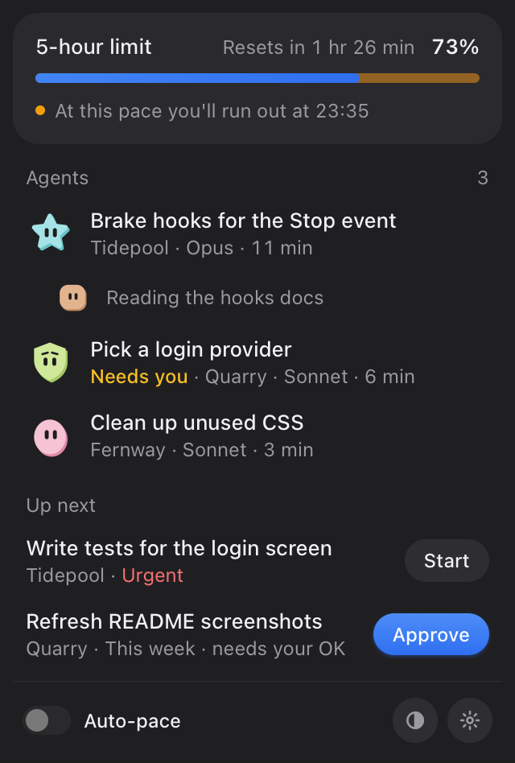
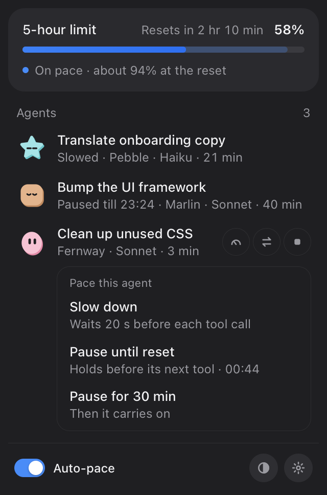
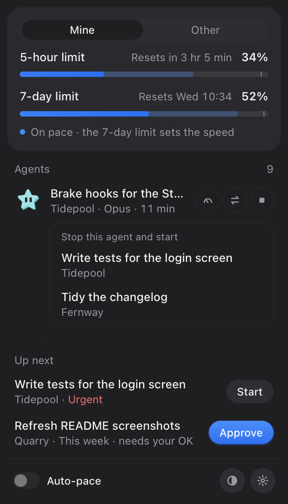

# Kadans

A speedometer for your Claude Code usage limits, in the macOS menu bar.

Kadans shows how fast you use your Claude limit, where you will land at the reset, and what each agent is doing.
You can slow, pause, compact, replace or stop an agent with one click. It runs on your Mac and is free and open source (MIT).

<p align="center">
  <picture>
    <source media="(prefers-color-scheme: dark)" srcset="docs/images/panel-brake-dark.png">
    
  </picture>
</p>

## Requirements

- macOS 13 or newer.
- Node.js 22 or newer.
- Claude Code on a Pro or Max plan. Claude Code only shares usage data on those plans.
- For the menu bar app: the Swift toolchain (Xcode or the Command Line Tools).

## Install

Kadans is built from source. There is no download and no binary in this repository.

```sh
git clone https://github.com/egemenmermer/kadans.git
cd kadans
node bin/kadans.mjs --help
```

In this file, `kadans` means `node bin/kadans.mjs`, run from the checkout. Keep the checkout where it is: the hooks and
the app point to it.

## First run

### 1. Preview the hooks, then install them

```sh
node bin/kadans.mjs install            # preview only: changes nothing
node bin/kadans.mjs install --apply    # write the changes, after a backup
```

`install` prints what it would change in your Claude Code `settings.json` (`~/.claude/settings.json`, or the folder in
`CLAUDE_CONFIG_DIR`). It writes nothing until you add `--apply`. Before writing, it copies the file to
`settings.json.kadans-backup-<time>`. Entries from other tools are left alone.

| Where | What it does |
|---|---|
| Status line | Records usage samples and prints a one-line gauge. Your old command is saved and restored on uninstall. |
| `Stop` hook | Throttle: can hand one approved task to a session when part of your limit would go unused. Off unless you opt in. |
| `PreToolUse` on `Agent` and `Workflow` | Brake: holds new sub-agents and workflows while the brake is on. |
| `PreToolUse` and `PostToolUse` on every tool | Pace: waits before a tool call if you slowed that session, halts it if you paused it. Auto-pace adds a short note when usage runs hot. |
| Session events and `Notification` | A small event log, so the agent list knows what runs and what needs you. |

Every hook fails open: if Kadans errors, Claude Code carries on as if it were not there.

If you already had a status line script, set `"chain"` in `~/.kadans/config.json` to its path. Kadans runs it with the same
input, so tools that rely on it keep working. The preview tells you when your status line differs from the chained path.

### 2. Build the menu bar app

```sh
scripts/build-app.sh
```

This builds `build/Kadans.app`, signs it ad hoc and copies it to `~/Applications/Kadans.app`. Nothing starts at login.
Use `--no-install` to build without copying. Because you built it yourself, macOS normally opens it without a warning. If
it does warn, right-click the app, choose Open, then confirm. `KADANS_REPO` sets the checkout the app uses.

You can also use Kadans without the app: `kadans status` and `kadans agents` print the same data.

### 3. The usage reading and the Keychain

The status line only sees usage when a chat on this Mac talks to Claude. To also see usage from claude.ai, the desktop or
phone app, or another computer, the app reads your own usage from Anthropic every 2 minutes. This is the same number
Claude Code's `/usage` shows.

- It reads one macOS Keychain item, `Claude Code-credentials` (your own account), through `/usr/bin/security`. macOS may
  ask you once whether to allow it.
- It uses only the access token and its expiry. It never stores, logs or refreshes the token. If the token has expired, it
  waits for Claude Code to sign in again.
- It sends one request to `api.anthropic.com/api/oauth/usage` and keeps only the percentages and reset times.
- To turn it off: `kadans config set usageApi false`. The gauge then uses the status line only.

## The panel

Click the menu bar item to open the panel. The item shows a small face and the percentage of your tightest limit. It
follows the light and dark look of macOS.

- **Gauge.** Your 5-hour window, and the 7-day window if your plan has one, with your pace and the time you are projected
  to run out. If the last reading is old, the gauge dims and says how old it is.
- **Agent list.** Every running Claude Code session and sub-agent, with a plain title, project, model, current context
  size and time. Titles come from `/rename`, Claude Code's own title, or the start of your first prompt. No model calls
  write them. Each agent has its own blob that shows its state: working, needs you, slowed or idle. Rows match Orca's own
  state, and working blobs move calmly.
- **Compact hint.** An idle chat that re-reads a big context on every turn gets a small "Compact?" mark. Compact types
  `/compact` into that chat's Orca terminal, after you click and confirm, and only if the chat is idle and its input line
  is empty. Outside Orca, Kadans tells you to type it yourself. Change or turn off the hint in Settings.
- **Close.** Idle chats have a Close button; chats that have been idle for 2 hours or more are folded into a group with
  Close all. Both ask first. A closed chat leaves the list at once.
- **Replace and queue.** Write tasks down for later. Kadans only starts the ones you approved. Replace stops an agent and
  starts one of them.
- **Auto-pace.** A switch in the panel. When usage runs hot, Kadans asks the agent to read less and skip sub-agents. If
  the brake holds for 10 minutes, it slows that session until the pace is fine again. It never touches what you slowed or
  paused yourself.
- **Menu bar item.** The face blinks now and then and moves while an agent works.

<p align="center">
  
  &nbsp;
  
</p>

### Brake and throttle

Kadans keeps a short history of your usage and projects where each window will be at its reset.

1. **Gauge.** Reading only. This is all you need.
2. **Brake.** If your pace would use up a window before it resets, Kadans denies *new* sub-agents and workflows and tells
   Claude why. Work that is already running keeps going. A task you marked urgent is let through, and so is a session
   started with `KADANS_ALLOW=1`.
3. **Throttle.** Off by default. If a good part of a window would go unused, Kadans can give a session the next task you
   approved, at most three per session per window. It needs `"accounts": { "<key>": { "gas": true } }` in `config.json`
   (`kadans status` shows the key) and `KADANS_THROTTLE=1` in that session.

Slow, pause and Auto-pace work on sessions that run under the account where Kadans is installed. Other accounts are
shown but never paced or throttled.

## Command reference

| Command | What it does |
|---|---|
| `kadans --help` | Show every command. |
| `kadans status [--json]` | Show the recorded accounts, windows and pace. |
| `kadans agents [--json] [--all]` | List the running agents. |
| `kadans agent stop <id>` | Stop one agent. |
| `kadans agent compact <id> [--dry-run]` | Type `/compact` into an idle chat's Orca terminal. |
| `kadans agent pace <id> slow\|pause\|none` | Slow, pause or resume one of your own sessions. |
| `kadans agent replace <agentId> <taskId> [--dry-run]` | Stop the agent, then start the task. |
| `kadans autopace on\|off` | Switch Auto-pace. |
| `kadans project add\|list`, `kadans task add\|list\|done\|skip\|urgent\|start`, `kadans approve <id>` | Projects and the task queue. |
| `kadans config get`, `kadans config set <key> <value>` | Show or change settings. Keys are listed in `--help`. |
| `kadans usage fetch [--json]` | Read your usage once. The app runs this for you. |
| `kadans install [--apply]`, `kadans uninstall [--apply]` | Preview or write the hook changes, with a backup. |
| `kadans kickoff [--dry-run]` | Optional: start the next 5-hour window with one small message. See below. |
| `kadans gas tick [--dry-run] [--json]` | Optional, off by default: start your next approved task when quota would go unused. See SECURITY.md. |

## Start the next window for me (kickoff)

The 5-hour window starts with your first message after the last window ended. If you want it to start at a time you
choose, `kadans kickoff` sends Claude one small message (`claude -p "Reply with the single word OK." --model haiku`) in an
empty temp folder, on your own account only. It does nothing unless you turned it on
(`kadans config set kickoff.enabled true`), the time is between `kickoff.from` and `kickoff.to` (default 07:00-23:00), and
your last window has ended. `kadans kickoff --dry-run` shows what it would do. Each kickoff spends a tiny amount of quota.

To have it checked every 15 minutes, add a macOS job once. The app never does this for you.

```sh
node bin/kadans.mjs kickoff schedule            # preview the job
node bin/kadans.mjs kickoff schedule --apply    # write the launchd job and load it
node bin/kadans.mjs kickoff unschedule --apply  # remove it
```

## Privacy

- There is no server and no account. Nothing is sent anywhere, with one exception: the usage reading above, which sends a
  single request to `api.anthropic.com`. Turn it off with `kadans config set usageApi false`.
- Kickoff is off by default. When you turn it on, it runs `claude`, which talks to Anthropic as usual.
- Kadans reads official data only: what Claude Code passes to its status line, and what `/usage` shows.
- It reads session transcripts under `~/.claude/projects` (read-only) for token counts, the model and titles.
- Everything it stores is in `~/.kadans`. Usage samples are kept 8 days, the event log 2 days.

The full list of what is read and written is in [SECURITY.md](SECURITY.md).

## Uninstall

```sh
node bin/kadans.mjs uninstall            # preview
node bin/kadans.mjs uninstall --apply    # remove the hooks, restore your old status line, back up first
node bin/kadans.mjs kickoff unschedule --apply   # only if you scheduled kickoff
rm -rf ~/Applications/Kadans.app ~/.kadans       # optional: the app and everything Kadans stored
```

## FAQ

**Which plans does it work with?** Claude Pro and Max. Claude Code only shares usage data on those plans, and only after
the first reply in a session, so the gauge can start empty.

**Will it slow my agents on its own?** Only the brake does, and only for new sub-agents when you would run out early.
Auto-pace is a switch you turn on. The throttle stays off until you enable it.

**Does it need my API key?** No. It never asks for one.

**Does it start tasks on its own?** Never without your approval. Start and Replace open a new Claude Code session in
Terminal.app, or in an Orca worktree if you use Orca, and only for a task you approved.

**What about Codex or an iPhone view?** Not now. The Mac menu bar comes first.

## Contributing, security, licence

See [CONTRIBUTING.md](CONTRIBUTING.md) and [SECURITY.md](SECURITY.md). Changes are listed in [CHANGELOG.md](CHANGELOG.md).

MIT, see [LICENSE](LICENSE). BoardUI Pro components and assets are not part of this repository and are not covered by this
licence. The panel's soft look follows BoardUI; the theme is plain CSS variables at the top of `app/web/panel.css`.
